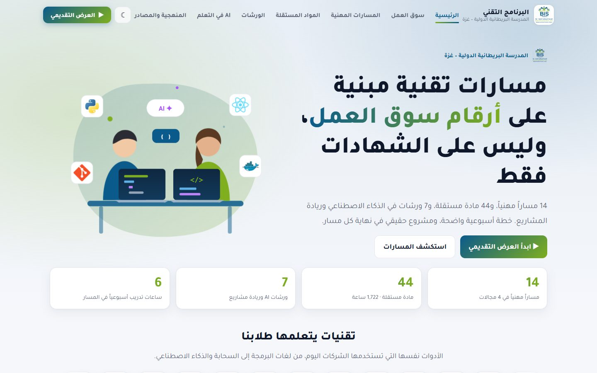
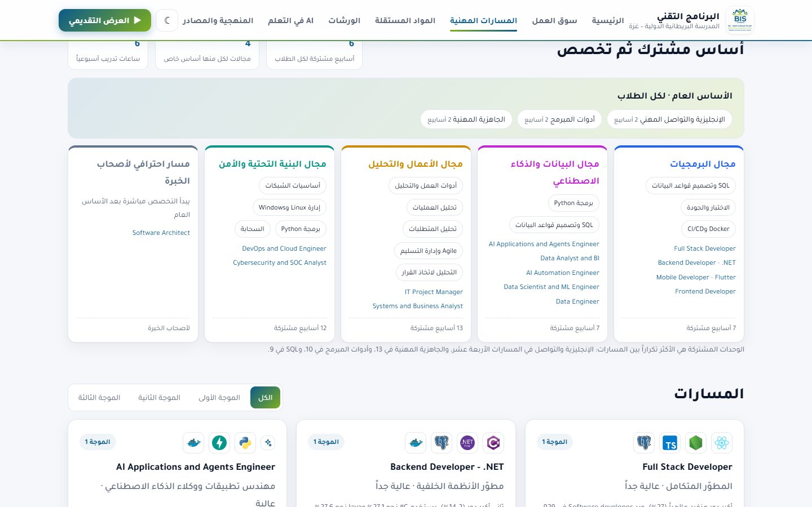
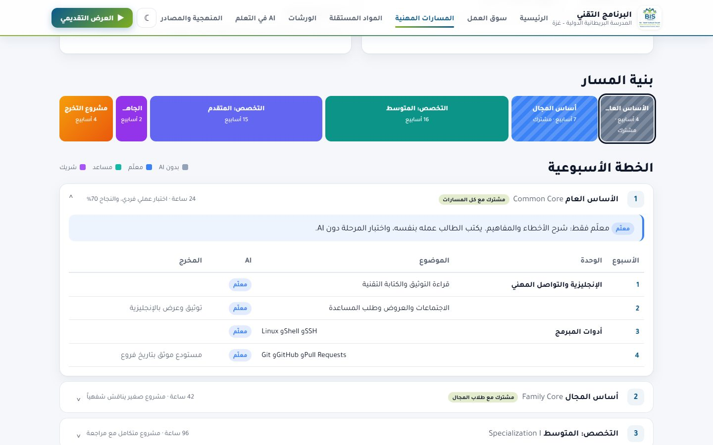
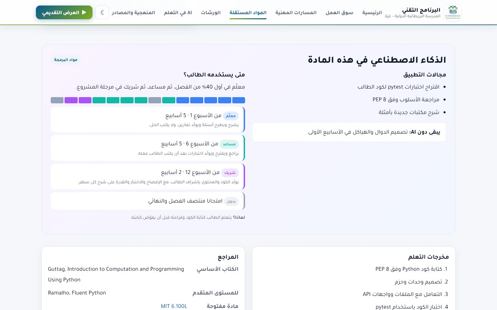
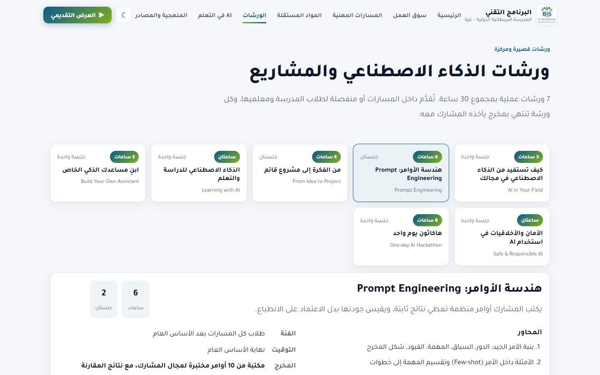
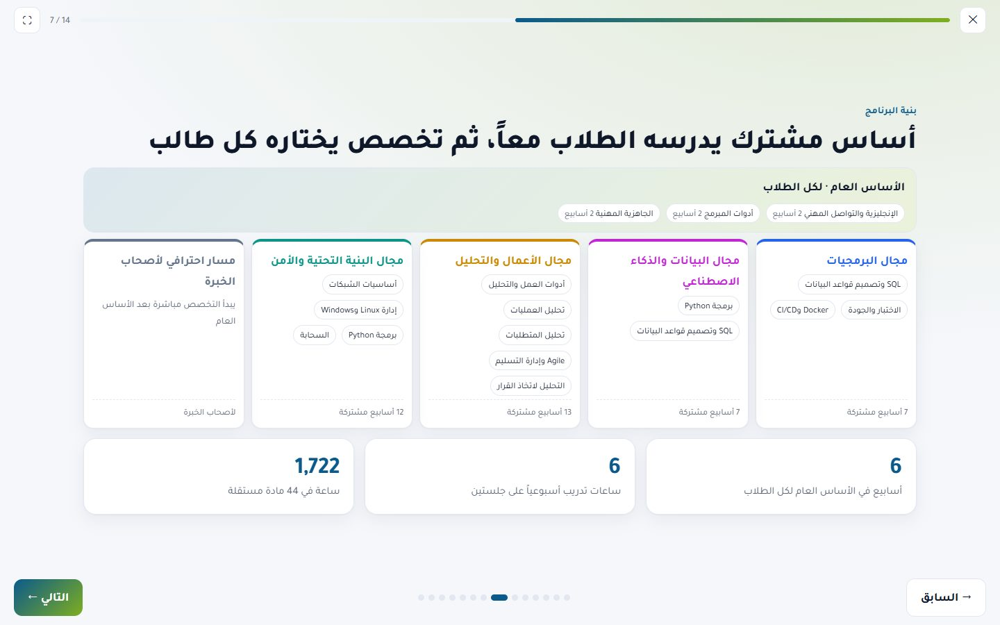
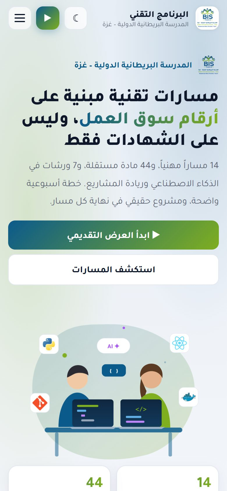
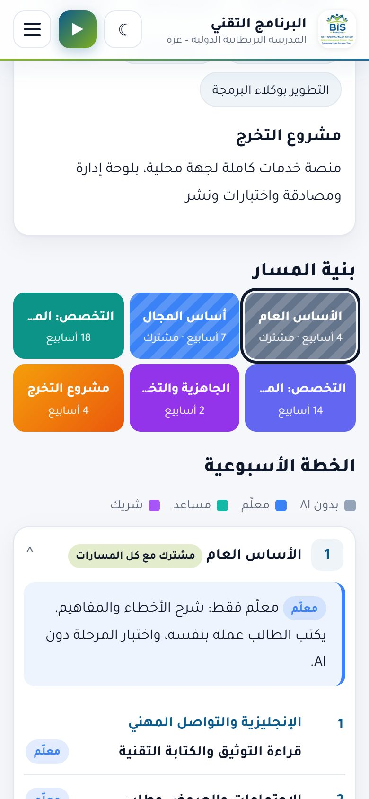

<div align="center">


# البرنامج التقني · المدرسة البريطانية الدولية – غزة

**مسارات تقنية مبنية على أرقام سوق العمل، وليس على الشهادات فقط**

موقع تفاعلي وعرض تقديمي لمناهج البرنامج التقني: 14 مساراً مهنياً، و44 مادة مستقلة، و7 ورشات في الذكاء الاصطناعي وريادة المشاريع، مع خطة أسبوعية لكل منها.


</div>

---

## لمحة



| المسارات المهنية | صفحة مسار |
|---|---|
|  |  |
| **مادة مستقلة وخطة استخدام AI** | **الورشات وبنك الأفكار** |
|  |  |
| **العرض التقديمي** | **على الجوال** |
|  |   |

## ماذا يحتوي الموقع؟

| القسم | المحتوى |
|---|---|
| **الرئيسية** | أبرز الأرقام، والتقنيات التي يتعلمها الطلاب، والموجة الأولى من المسارات، وخطة الإطلاق خلال 24 شهراً |
| **سوق العمل** | أرقام فلسطينية وإقليمية ودولية بمصادرها، وقاعدة اختيار المسارات ودرجة كل مسار من 8 |
| **المسارات المهنية** | 14 مساراً في 4 مجالات تبدأ بأساس مشترك، ولكل مسار خمس مراحل وخطة أسبوعية ومشروع تخرج |
| **المواد المستقلة** | 44 مادة بمخرجات تعلم، وخطة أسبوعية بمختبر، وتقييم، ومراجع جامعية |
| **الورشات** | 7 ورشات (30 ساعة)، منها هندسة الأوامر ومن الفكرة إلى مشروع قائم، وبنك من 12 فكرة مشروع |
| **AI في التعلم** | أربعة أوضاع لاستخدام الذكاء الاصطناعي، وخطة لكل مادة توضح متى يُستخدم ومتى يُمنع |
| **المنهجية والمصادر** | حدود البحث، ومؤشرات القياس، وروابط كل المصادر |
| **العرض التقديمي** | 14 شريحة تملأ الشاشة، مع التنقل بلوحة المفاتيح وملء الشاشة |

### بنية البرنامج

```text
الأساس العام (لكل الطلاب)
  └─ أساس المجال
       ├─ البرمجيات ................ Full Stack · Backend · Frontend · Mobile
       ├─ البيانات والذكاء الاصطناعي .. AI Engineer · AI Automation · Data Analyst · Data Scientist · Data Engineer
       ├─ الأعمال والتحليل ........... IT Project Manager · Systems & Business Analyst
       └─ البنية التحتية والأمن ...... DevOps & Cloud · Cybersecurity
  └─ مسار احترافي لأصحاب الخبرة ...... Software Architect
```

التدريب 6 ساعات أسبوعياً على جلستين، وكل مسار ينتهي بمشروع لجهة حقيقية.

### الذكاء الاصطناعي في كل أسبوع

| الوضع | دور الذكاء الاصطناعي |
|---|---|
| بدون AI | الامتحانات وما يجب أن يتقنه الطالب بنفسه |
| معلّم | يشرح ويطرح أسئلة ويولّد تمارين، ولا يكتب الحل |
| مساعد | يراجع ويقترح ويولّد اختبارات بعد أن يكتب الطالب عمله |
| شريك | يولّد الكود والمحتوى بإشراف الطالب، مع الإفصاح والاختبار |

## التشغيل

يتطلب [Node.js](https://nodejs.org) الإصدار 20 أو أحدث.

```bash
npm install
npm run dev
```

ثم افتح http://localhost:5180. العرض التقديمي على `#/present`. للتنقل استخدم الأسهم، وللخروج Esc.

| الأمر | الوظيفة |
|---|---|
| `npm run dev` | تشغيل نسخة التطوير |
| `npm run build` | فحص الأنواع ثم بناء النسخة النهائية في `dist/` |
| `npm run preview` | تجربة النسخة المبنية على http://localhost:4180 |
| `npm run typecheck` | فحص TypeScript فقط |

## النشر

الموقع ثابت بالكامل، وروابطه من نوع `#/`، فلا يحتاج إعدادات خادم. حجم النسخة المبنية نحو 1.1MB، وتعمل دون إنترنت لأن الخط والشعارات مضمنة فيها.

- **Netlify أو Cloudflare Pages أو Vercel:** أمر البناء `npm run build`، ومجلد النشر `dist`.
- **GitHub Pages أو أي استضافة:** ارفع محتوى `dist/` كما هو. يعمل من أي مجلد فرعي.

## بنية المشروع

```text
├── data-src/              مصادر المحتوى
│   ├── courses1.txt       المواد 1–22
│   ├── courses2.txt       المواد 23–44
│   ├── modules.txt        وحدات المسارات وموضوعاتها الأسبوعية
│   ├── paths.cjs          المسارات ومؤشرات سوق العمل
│   └── ai.txt             خطة استخدام AI لكل مادة
├── scripts/
│   └── build-data.mjs     يحوّل المصادر إلى src/data/curriculum.json
├── public/                الشعار
├── docs/screenshots/      صور هذا الملف
└── src/
    ├── pages/             صفحات الموقع والعرض التقديمي
    ├── components/        مكونات الواجهة والشعارات والرسمة المتحركة
    ├── data/              أرقام السوق والورشات والبيانات المولّدة
    ├── types.ts           أنواع البيانات
    └── *.css              التنسيقات
```

## تعديل المحتوى

كل المحتوى في `data-src/`، ويُولَّد ملف البيانات تلقائياً عند `npm run dev` و`npm run build`.

- **مادة:** عدّل كتلتها في `courses1.txt` أو `courses2.txt`. كل سطر يبدأ بحرف: `D` الوصف، و`M` أهميتها في السوق، و`O` المخرجات، و`W` الأسابيع بصيغة `موضوع~مختبر` مفصولة بـ`;`، و`P` المشروع، و`B` و`A` المراجع، و`U` المادة المفتوحة.
- **خطة AI لمادة:** سطر في `ai.txt` بصيغة `رقم|السياسة|تطبيقات;مفصولة|ما يبقى دون AI`.
- **وحدة في مسار:** `modules.txt` بصيغة `معرّف|الاسم|موضوع;لكل;أسبوع|المخرج`.
- **مسار:** `paths.cjs`، وتُحسب درجته وموجة إطلاقه تلقائياً.
- **أرقام السوق والورشات:** `src/data/market.ts` و`src/data/workshops.ts`.

## المصادر

الأرقام مأخوذة من Stack Overflow Developer Survey (2025 و2026)، وUS Bureau of Labor Statistics (2025–35)، وتقرير European Training Foundation (2026)، وStanford AI Index (2026)، والجهاز المركزي للإحصاء الفلسطيني، وPortland Trust، وtrade.gov. روابطها كاملة في صفحة **المنهجية والمصادر** داخل الموقع.

> لا توجد إحصائية منشورة لحصة كل تخصص داخل فلسطين، لذلك يعتمد الترتيب على مؤشرات بديلة معلنة المصدر. الساعات والمناهج وخطة استخدام AI تصميم مهني يحتاج مراجعة مختصين قبل التدريس.

---

<div align="center">

إعداد وتصميم **المهندس صادق مجدي عاشور**

للمدرسة البريطانية الدولية – غزة · British International School, Gaza · American High School Track

© 2026 جميع الحقوق محفوظة

</div>
